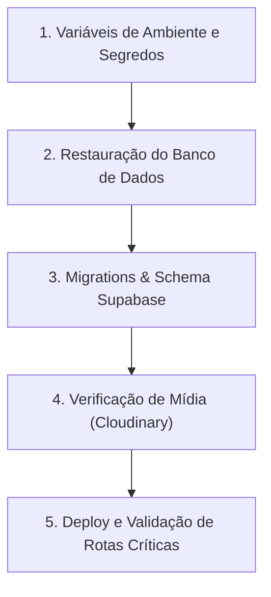

# Plano de Recuperação de Desastres (Disaster Recovery Plan - DRP)

**Projeto:** Catálogo Interativo / VitrineZap SaaS  
**Versão:** 1.0  
**Data:** 2026-10-22  
**Responsável Técnico:** Equipe de Engenharia / Proprietário do Sistema  

---

## 1. Escopo e Objetivos

Este documento estabelece o procedimento operacional padrão para a restauração completa dos serviços do sistema em situações de desastre, corrupção de dados, falha grave de infraestrutura ou comprometimento de segurança.

- **RPO (Recovery Point Objective):** Máximo de 24 horas (ou até o último snapshot PITR do banco).
- **RTO (Recovery Time Objective):** Menor que 60 minutos para restabelecimento total da operação.

---

## 2. Inventário de Componentes e Serviços

| Componente | Provedor | O que armazena | Método de Backup |
| :--- | :--- | :--- | :--- |
| **Aplicação Web & APIs** | Vercel | Código fonte, SSR, Server Actions e rotas de API | Git (GitHub) + Vercel Deployment Rollback |
| **Banco de Dados Relacional** | Supabase (PostgreSQL) | Lojas, veículos, contratos, assinaturas, tickets, usuários | Supabase Automated Daily Backups + PITR |
| **Mídia e Documentos** | Cloudinary | Fotos de estoque, banners, logos, CRLVs, assinaturas | Cloudinary Backup / Multi-cloud sync |
| **E-mails Transacionais** | Resend | Histórico de disparos de contratos e notificações | Painel Resend / Logs de auditoria |

---

## 3. Ordem Estrita de Restauração

Em caso de reinicialização completa ou restauração de emergência, execute rigorosamente a seguinte ordem:



---

## 4. Procedimento Operacional Passo a Passo

### Etapa 1: Garantia dos Segredos de Ambiente
1. Acesse o painel da **Vercel** > Projeto > **Settings** > **Environment Variables**.
2. Garanta que todas as variáveis de ambiente listadas em `.env.example` estejam preenchidas com as credenciais válidas e seguras (especialmente `SUPABASE_SERVICE_ROLE_KEY`, `CLOUDINARY_API_SECRET`, `SESSION_SECRET`, `ADMIN_PASS`).

### Etapa 2: Restauração do Banco de Dados (Supabase)
1. Acesse o console do **Supabase**: `https://supabase.com/dashboard/project/<PROJECT_ID>/database/backups`.
2. Para restauração em ponto no tempo (PITR), selecione o timestamp imediatamente anterior ao incidente.
3. Se for restauração manual via arquivo de dump (`.sql`):
   - Abra o **SQL Editor** do Supabase.
   - Execute o script na ordem correta de integridade referencial:
     1. `stores`
     2. `vehicles`
     3. `store_users`
     4. `store_user_memberships`
     5. `contracts`
     6. `contract_signers`
     7. `contract_events`
     8. `tickets`
     9. `ticket_attachments`
     10. `logs_auditoria`
4. Aplique as migrations pendentes localizadas na pasta `supabase/migrations/` em ordem cronológica (de `001_` até `019_security_and_mfa.sql`).

### Etapa 3: Recuperação de Mídia e Arquivos (Cloudinary)
1. Caso imagens tenham sido acidentalmente excluídas:
   - Acesse o console do Cloudinary > **Media Library**.
   - Verifique a pasta lixeira / Backup Bucket.
   - Restaure os arquivos mantendo os `public_id` correspondentes.
2. Os links gravados no banco de dados utilizam URLs públicas estruturadas (`res.cloudinary.com/...`).

### Etapa 4: Deploy e Validação (Smoke Tests)
1. Execute a suíte de testes de integridade localmente:
   ```bash
   node tests/auth-central.test.js
   node tests/validations.test.js
   node tests/tickets.test.js
   ```
2. Realize novo deploy na branch principal (`main`).
3. Verifique os seguintes fluxos essenciais:
   - Vitrine pública: `/{slug}` carrega estoque e WhatsApp funcional.
   - Login central: `/entrar` autentica o lojista e direciona para o painel.
   - Contratos: visualização e download do PDF de contrato em `/api/contracts/{id}/pdf`.
   - Tickets: listagem e criação de tickets de suporte.

---

## 5. Matriz de Contatos e Notificação de Incidentes

- **Líder Técnico / Responsável:** Gabriel / Kaique
- **Suporte Supabase:** support@supabase.io
- **Suporte Cloudinary:** support@cloudinary.com
- **Suporte Vercel:** vercel.com/help

---

## 6. Revisão Pós-Incidente (Post-Mortem)

Após a recuperação do serviço, conduza reunião de Post-Mortem em até 48 horas registrando:
1. Causa raiz do incidente.
2. Tempo de indisponibilidade (downtime).
3. Dados afetados (se houve).
4. Medidas preventivas adotadas para evitar reincidência.
